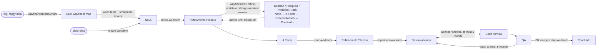

# Skills

A Claude Code plugin that runs a software development flow from a Jira card to a merged PR, and holds every repository to the same documentation and agent harness.

## Install

In Claude Code:

```text
/plugin marketplace add davi-lucciola/skills
/plugin install davi@davi-lucciola
```

Then run the one-time machine setup:

```text
/davi:onboarding
```

Update with `/plugin marketplace update davi-lucciola`.

## The flow

Jira is the source of truth. Every skill checks the card's status before it starts, moves the card when it finishes (or blocks it with a structured comment), and leaves a `**[skill]**` comment trail. The card also links the branch, spec, PR, and prototype, and the QA evidence (screenshots, videos, logs) is attached to it, so anyone can pick a work item up from the card alone.

How cards are shaped (details in `plugins/davi/references/jira.md`):

| Rule | What it means |
|---|---|
| Issue types | **Work items** end in a PR and run the delivery workflow: **Story** when a user would notice the change, **Habilitador** when not, **Bug**. **Refinement tickets** never produce a PR, run the short workflow Novo → A Fazer → Desenvolvendo → Concluído, and **block** the work item they refine: **Decisão** (grilling), **Pesquisa** (research), **Protótipo** (prototype, or the item's screens), **Task** (manual work: an account, DNS, a repo). **Epic** groups them; **Subtask** = one slice of `tasks.md`. |
| Labels | Every card of a product carries one project label (for example `acme-site`), set in `AGENTS.md` › `## Jira` and inherited from the Epic. All JQL filters by it. The only other labels are `wayfinder:map` on a map Epic and `wayfinder:task` on Decisão, Pesquisa, and Protótipo. |
| Language | Root cards and their comments are in **pt-BR**. Subtasks, specs, ADRs, code, commits, and PRs are in **English**. |
| Evidence | Attached to the card with `uploadAttachmentToJiraIssue`, named `<KEY>-qa<N>-<case>.<ext>`. |

A Jira project is prepared once with `plugins/davi/references/jira-setup.md` (new issue types, their icons, and the two workflows, through Claude in Chrome).



`/davi:wayfind-workitem next <EPIC|KEY>` drives everything below: it advances an Epic or a card by exactly one step, invoking the skill the card's status calls for.

| Skill | When | What it does |
|---|---|---|
| `wayfind-workitem` | Anytime | Macro orchestrator. `chart` maps a foggy idea as a Jira Epic of work items (Story, Bug, Habilitador) and the refinement tickets that block them (Decisão, Pesquisa, Protótipo, Task). `next` advances one step. `status` shows where an Epic or card stands, what is blocked, and the next command. `lint` checks Definition of Ready. |
| `onboarding` | Once per developer | Checks the tools and connects the MCPs (Atlassian/Jira, Context7, Google Drive, Chrome DevTools, Claude in Chrome). Checks the Jira project's issue types, workflows, and attachments, writes `~/.claude/davi.json`, and runs a smoke test. |
| `project-harness` | Once per repo, re-run to audit | Creates or audits `AGENTS.md`, the standards, ADRs, C4, specs, `GLOSSARY.md`, `DESIGN.md`, and `README.md`. |
| `create-workitem <story\|bug\|habilitador>` | New need | Writes a brief pt-BR card in **Novo**, with the right type (Story or Habilitador) and the project label. Splits large requests into vertical slices with blocking links, prefactoring first. |
| `refine-workitem <KEY>` | Product refinement | Reads the docs and code, grills the PO, sharpens `GLOSSARY.md`, creates and resolves the refinement tickets that block the card, and fills in the business rules and Dado/Quando/Então criteria. |
| `design-workitem <KEY>` | Items with UI | Resolves the item's UI **Protótipo**: builds the screens in Claude Design on top of `DESIGN.md`, gets the PO's approval, and links them on the card. |
| `spec-workitem <KEY>` | Technical refinement | Explores the code and options with the ponytail ladder (smallest complete change), agrees on test seams, and writes `docs/specs/changes/<KEY>-<slug>/` and ADRs, plus one English Subtask per slice. |
| `implement-workitem <KEY>` | Development | Implements the slices with TDD (moving their Subtasks), loops with the code reviewer and then QA, attaches the evidence to the card, opens the PR, and marks it ready. |
| `review-workitem` | Inside the loop or standalone | Independent hypotheses first, then the Spec, Standards, Security, Lean, and Design axes, with severities and non-blocking follow-ups. Never edits code. |
| `qa-workitem <KEY>` | Inside the loop or standalone | Runs end-to-end cases from the spec, the acceptance criteria, and the checklists. Records evidence (mp4, screenshots, console, network) and attaches it to the card. |
| `pr-workitem` | Inside the loop or standalone | Writes the PR body: visual, acceptance-criteria traceability, evidence, merge danger. |
| `ship-workitem <KEY>` | After merge | Archives the spec, updates the living docs, turns shortcuts and review follow-ups into "Dívida técnica" Habilitador cards on request, cleans the worktrees, and moves the card to **Concluído**. |

Reference skills used by the flow:

| Skill | What it does |
|---|---|
| `ponytail` | The smallest complete change: a ladder from "does it need to exist?" to "the minimum that works", never cutting validation, security, or accessibility. Level ultra in `spec-workitem`, full in the implementer, and the Lean axis of the review. |
| `tdd` | Good tests, seams agreed in `design.md`, anti-patterns, mocking at boundaries, red → green. |
| `grilling` | The interview primitive: decisions as a tree, asked in rounds with a recommended answer each; facts go to subagents. Resolves **Decisão** tickets; used by `chart` and `refine-workitem`. |
| `domain-modeling` | Challenges terms against `GLOSSARY.md`, updates it inline, and offers an ADR only for hard-to-reverse trade-offs. Runs with `grilling`. |
| `research` | Facts from primary sources in a background subagent, every claim cited; the write-up is attached to the **Pesquisa** ticket. |
| `prototype` | A throwaway answer to one design question: UI variants in Claude Design (with `ui-design-direction` and `ui-ux-pro-max`), or an interactive logic artifact or spike. Resolves **Protótipo** tickets. |
| `ui-design-system`, `ui-design-direction`, `ui-ux-pro-max` | Maintain and apply each project's `DESIGN.md`. |

The cross-cutting rules live in `plugins/davi/references/`: `jira.md` (source-of-truth contract: issue types, project label, language, evidence), `jira-setup.md` (preparing a Jira project), `blocked.md` (block template and sweep), `preflight.md` (checklist before implement and QA), `loop.md`, `git.md`, and `openspec-format.md`.

## Guards

The plugin ships four `PreToolUse` guard hooks, on by default:

| Guard | Blocks |
|---|---|
| `guard-secrets` | Reading or piping dotenv files, SSH keys, and credential files. `scripts/env-check.py` shows which keys are set without their values. |
| `guard-key-literals` | Writing something that looks like a live key into a file. |
| `guard-protected-push` | Pushing to or force-pushing `develop`, `main`, or `master`. |
| `guard-delete-outside` | `rm`, `find -delete`, and `git clean` outside the project and its `<name>--*` worktrees. |

Switch one off with `"guards": {"<name>": false}` in `~/.claude/davi.json`. Tests: `bash plugins/davi/hooks/tests/test_guards.sh`.

Subagents shipped with the plugin:

| Agent | Model |
|---|---|
| `workitem-implementer` | inherited |
| `workitem-reviewer` | always `sonnet` |
| `workitem-qa` | inherited |

## Project standard

Every repository in this flow has the following layout. `project-harness` creates it.

```
AGENTS.md                         index for people and agents (+ CLAUDE.md → @AGENTS.md)
DESIGN.md                         design contract: tokens, components, patterns, accessibility
GLOSSARY.md                       business domain terms
README.md
<important-folder>/AGENTS.md      local rules
docs/architecture/standards/*.md  the modular body of AGENTS.md
docs/architecture/decisions/NNN-ADR-<slug>.md
docs/architecture/c4/*.md         Mermaid C4 diagrams
docs/specs/<capability>/spec.md   OpenSpec-style specs (+ changes/, changes/archive/)
```

## Repository layout

```
.claude-plugin/marketplace.json   marketplace "davi-lucciola"
plugins/davi/
├── .claude-plugin/plugin.json
├── .mcp.json                     Context7 + Chrome DevTools
├── agents/                       implementer, reviewer (sonnet), qa
├── hooks/                        hooks.json + guard scripts + tests
├── references/                   jira.md, jira-setup.md, blocked.md, preflight.md, git.md, loop.md, openspec-format.md
├── scripts/                      env-check.py
└── skills/<name>/SKILL.md
```

## Contributing

- Edit `plugins/davi/skills/<name>/SKILL.md`. Skills and repo files are written in English; the Jira text they generate follows `references/jira.md` › Language (pt-BR on root cards).
- Validate with `claude plugin validate plugins/davi` and `claude plugin validate .`.
- Test locally with `/plugin marketplace add ./` from the repo root, then `/plugin install davi@davi-lucciola`.
- Bump `version` in `plugins/davi/.claude-plugin/plugin.json` on every release.

## Roadmap

Ideas from comparing this flow with [super-board](https://github.com/EricTechPro/super-board), not built yet:

- **`collect-workitem`:** intake from Sentry, PostHog, PRs, and issues. Each candidate is verified, then filed as a bug through `create-workitem`.
- **Model routing by slice difficulty:** for example Sonnet for easy slices in `workitem-implementer`, to cut cost.
- **QA that leaves an e2e suite:** the implementer commits Playwright tests from the AC cases, so regressions are caught in CI without an agent.
- **Risk labels** (`money`, `auth`, `schema`) that require a named human reviewer and check that the reviewed SHA equals the PR head before `gh pr ready`.
- **One writing standard** for commits, cards, PR bodies, and comments.
- **Plugin evals** (`claude plugin eval`) for the critical skills.
- **A bounded UI critique → fix loop** for polishing one page against `DESIGN.md`.
- **A session-start hook** that removes merged worktrees.

## Credits

- Ported from [beyondx-tech/skills](https://github.com/beyondx-tech/skills), the BeyondX version of this flow. This repo follows it.
- Flow and skill style: [davi-lucciola/skills](https://github.com/davi-lucciola/skills) and [mattpocock/skills](https://github.com/mattpocock/skills) (`to-tickets`, `domain-modeling`, `to-spec`, `implement`, `implement-spec`, `code-review`, `pr`). `tdd` and `wayfind-workitem` (from `wayfinder`) are adapted from it (MIT). See their `NOTICE.md`.
- `ponytail`: adapted from [DietrichGebert/ponytail](https://github.com/DietrichGebert/ponytail) (MIT). See its `NOTICE.md`.
- Guard hooks, `ready-lint`, the block template, and preflight: adapted from [EricTechPro/super-board](https://github.com/EricTechPro/super-board) (MIT). See `plugins/davi/hooks/NOTICE.md`.
- Spec format: [OpenSpec](https://github.com/Fission-AI/OpenSpec), adapted without the CLI.
- `ui-design-direction`: adapted from Anthropic's `frontend-design` (Apache-2.0). See its `NOTICE.md`.
- `ui-ux-pro-max`: adapted from [ui-ux-pro-max-skill](https://github.com/nextlevelbuilder/ui-ux-pro-max-skill). See its `NOTICE.md`.
