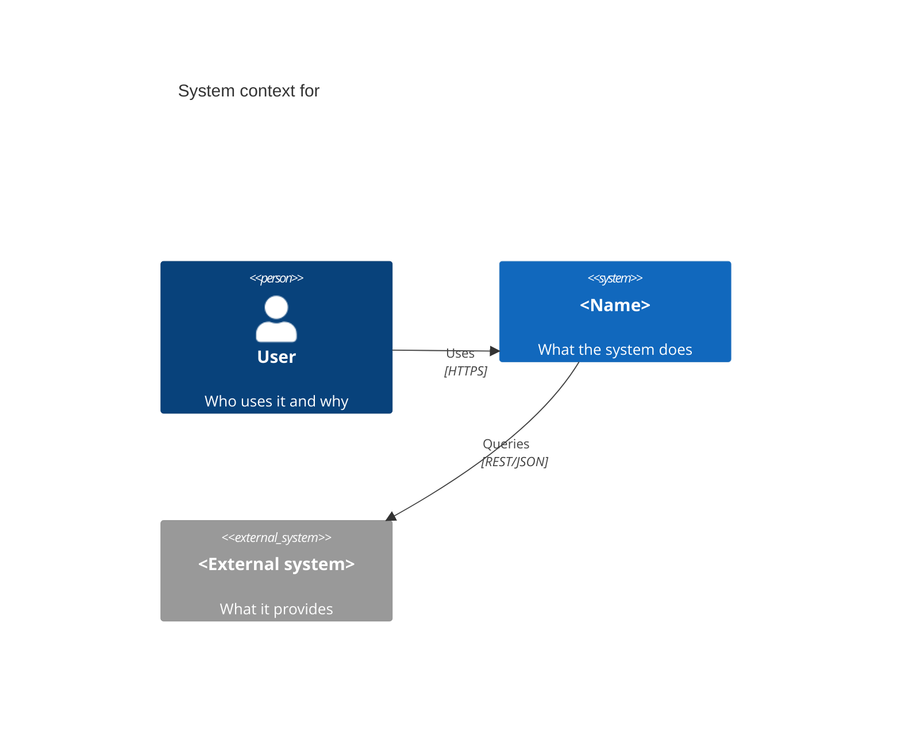

# C4 — Level <1: Context | 2: Containers | 3: Components of <container>>

<2–4 sentences: what this diagram shows and what it leaves out.>

<!--
Level 2 uses C4Container with Container(...), ContainerDb(...), ContainerQueue(...) inside System_Boundary(...).
Level 3 uses C4Component with Component(...) inside Container_Boundary(...).
No HTML in labels; quote labels with special characters.
-->

## Elements

| Element | Responsibility | Technology | Owner |
|---|---|---|---|
| | | | |

## Related decisions

- [NNN — <title>](../decisions/NNN-ADR-<slug>.md)
